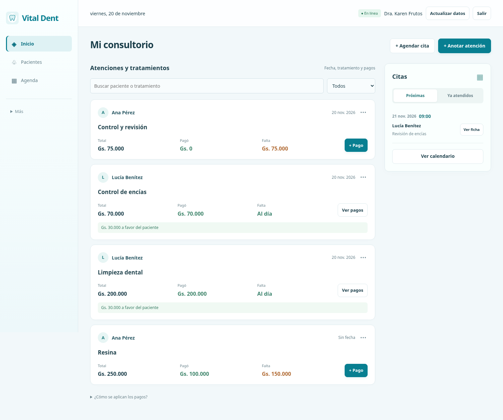

# Vital Dent

Gestión odontológica para **https://vdnt.bmimportexport.com.py/** con PHP 8.2+, PDO y MySQL/MariaDB. Interfaz clara en cyan y pastel para PC e iPhone.

## Actualización 3.0

[Descargar ZIP](updates/vital-dent-actualizacion-3.0.0.zip) y extraer directamente en **VDNT**, donde están `public/` y `server/`. Conserva `server/config.php` y datos. El nuevo inicio no necesita cambios SQL. [Instrucciones](ACTUALIZAR.txt).

El inicio usa fichas, no una grilla: fecha, paciente, tratamiento, total, pagó y falta. **Anotar atención** registra el tratamiento, la nota y el pago opcional en una sola operación. **Atender** completa una cita del día. Próximas citas y pacientes ya atendidos están a la vista. Editar, eliminar y ver pagos están en el menú de la ficha; Pagos y Ajustes se encuentran en Más.



Los datos antiguos se conservan. Las fechas desconocidas aparecen como Sin fecha. Los pagos nuevos pueden estar vinculados a un tratamiento; los anteriores y los excedentes se aplican al saldo más antiguo del mismo paciente. Este reparto se calcula para la vista sin reescribir pagos. El sobrante queda a favor y los totales coinciden con los de la ficha del paciente. Eliminar el importe de un tratamiento conserva su nota clínica y pagos.

## Hosting

[Instalación y configuración privada](INSTALACION.md). La raíz pública debe ser **VDNT/public**; `server/config.php` queda fuera de ella. No se necesitan Node ni compilación en producción. GitHub almacena el código; el hosting ejecuta PHP. El alias www se redirige a la dirección sin www.

PWA instalable, acceso opcional recordado por 30 días, historias/odontograma, calendario mensual, sesiones con imágenes/PDF, tratamientos, pagos y respaldo/restauración. La base centralizada se comparte entre dispositivos. Las escrituras requieren Internet; no se cachean historias ni credenciales. Usar Actualizar datos para traer cambios hechos desde otro dispositivo. El servidor evita que una copia antigua sobrescriba cambios nuevos.

## Desarrollo y pruebas

Crear una base **vacía de prueba cuyo nombre termine en `_test`**, importar `database/schema.sql`, copiar la plantilla de configuración privada y usar `app_url=http://localhost:8090` y `setup_token=development-test-token-only-1234567890` exclusivamente en pruebas. Nunca usar esa clave en producción.

```sh
php -S localhost:8090 -t public
```

En otra terminal:

```sh
npm ci
npx playwright install chromium
VITAL_DENT_TESTS=1 php tests/db-fixture.php reset
npm test
```

El reset borra exclusivamente la base de prueba y rechaza configuraciones de producción. `CHROMIUM_PATH` y `PHP_BIN` permiten seleccionar herramientas instaladas. Las pruebas crean datos ficticios, cambian la contraseña de prueba y necesitan comenzar con el reset anterior.

Validación: flujos clínicos anteriores, autenticación/sesiones, origen y redirección www, adjuntos, respaldo/restauración, dinero recibido/aplicado/crédito (200 escenarios), carga conjunta de atención y pago, fallos de guardado, pagos parciales, edición sin duplicados, citas próximas y atendidas, persistencia, aislamiento de pacientes, y vistas de 390/320 px. Se probó en Chromium y PHP/MariaDB; Safari en iPhone físico se verifica en el hosting.

`python3 scripts/build-update.py` genera el ZIP reproducible con permisos 755/644 y su checksum; excluye configuración privada y datos. Hacer respaldo antes de actualizar. El JSON de exportación contiene datos clínicos sin cifrar; conservarlo en almacenamiento privado. El importador JSON admite hasta 30 MB; para bases mayores usar backups SQL del hosting.
